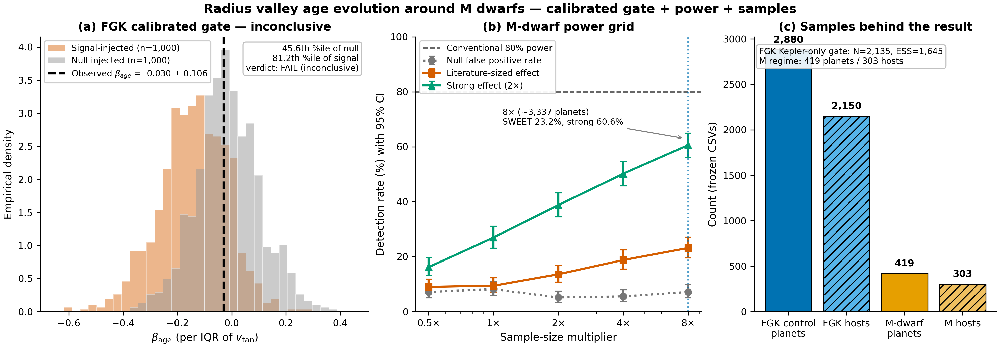
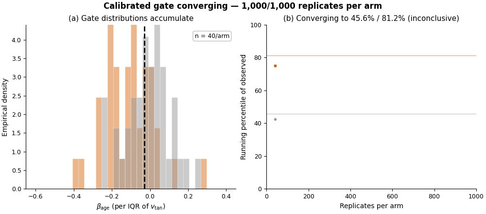
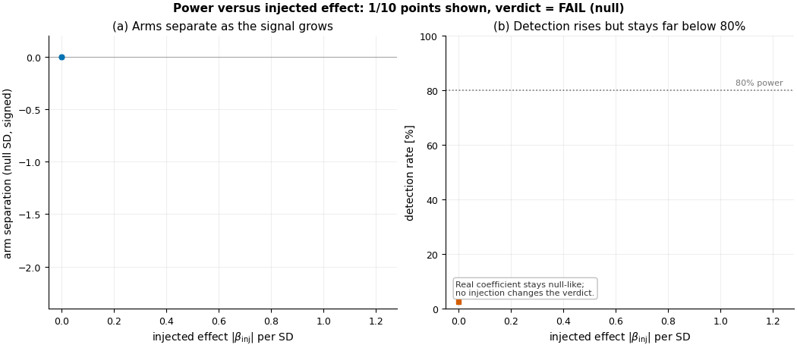

# Radius-valley age evolution around cool stars

A reproducible study of whether current archival data can distinguish a
literature-sized age effect on the sub-Neptune fraction from no effect. The
answer is inconclusive, and the repo quantifies exactly what would resolve it.


-999999)


> **Start here.** Read [REPO_STATUS.md](REPO_STATUS.md) before using any number.
> It states which results are current and which older files are historical.
> The current, self-contained reproducibility bundle is [`repro/v2/`](repro/v2/).



*Figure: (a) FGK control gate, with the observed age coefficient at the 45.6th
percentile of the null and the 81.2nd of the signal ensemble (both admissible,
verdict FAIL). (b) M-dwarf power grid with 95 percent intervals; at 8x the
literature-sized effect is detected in only 23.2 percent of realizations.
(c) The frozen samples behind the result. Rebuild with
`python figures/make_overview.py`.*



*The calibrated gate converging to the published percentiles as replicates
accumulate. Rebuild with `python figures/make_gate_animation.py`.*



*The full ten-point power-versus-effect curve being built from the frozen v2
results. The arms separate and detection rises with the injected effect, yet
the verdict stays FAIL at every point because the real coefficient's null
placement does not change. Rebuild with
`python figures/make_power_effect_animation.py`.*

## What this repository provides

- **Frozen, checksummed inputs.** Every number can be reproduced offline from
  `data/` with `sha256sum -c data/checksums.sha256`.
- **A calibrated decision gate.** Null and signal ensembles are injected into
  the same noise and selection structure, and the real fit must separate them.
  The verdict is FAIL (inconclusive), not a detection or a null claim.
- **A quantified path forward.** A 15-cell Monte Carlo power grid, a full
  power-versus-effect curve, and an explicit audit of age-proxy limitations.
- **A versioned v2 bundle.** `repro/v2/` contains the exact scripts, results,
  figures, and provenance records behind the current manuscript, with portable
  paths and a checksum manifest.

## Headline results (v2, authoritative)

| Quantity | Value |
|---|---|
| FGK control age coefficient | -0.0296 +/- 0.1061 per IQR |
| FGK percentile in null / signal | 45.6% / 81.2% |
| FGK arm separation / likelihood ratio | -1.01 null SD / 0.68 |
| Cool-host age coefficient | +0.0458 +/- 0.3210 per IQR |
| Cool-host percentile in null / likelihood ratio | 55.3% / 0.93 |
| Cool-host arm separation | -0.19 null SD (arms nearly coincident) |
| Gate verdict | **FAIL (inconclusive)** for both samples |
| 8x literature-sized detection | 23.2% [19.6, 27.2] |
| 8x strong-effect detection | 60.6% [56.2, 64.9] |
| Null false-positive rate per cell | 5.2--8.2% (pooled 6.68%) |
| Interval coverage per cell | 85.2--95.4% (pooled 91.3%) |
| 80%-power scale (model dependent) | 1.7e4 to 4.7e4 planets, quoted as a bracket |
| External age-ordering check | Spearman rho = 0.372, p = 0.0023, n = 65 |

The apparent wrong-sign binned age signal is a **period-mixing artifact**:
kinematically old hosts carry slightly longer-period planets, and the
sub-Neptune fraction rises steeply with period under a fixed radius cut.

## Repository map

```
code/          numbered analysis pipeline (01-15, B1/B2, appendix_*, audits)
data/          frozen CSV inputs + checksums.sha256
results/       pipeline outputs; results/highrep/ holds the raw replicates
figures/       overview figure, gate animation, and earlier publication figures
manuscript/    revision notes and build files (LaTeX source withheld)
colab/         high-replicate gate and power-grid experiment
docs/          METHODS, REPRODUCIBILITY, DATA_DICTIONARY, USAGE_COLAB, notes
repro/v2/      CURRENT bundle: scripts, results, figures, provenance, checksums
REPO_STATUS.md authority map and supersession table (read this first)
```

## Quickstart

```bash
pip install -r requirements.txt
sha256sum -c data/checksums.sha256
python code/audit_highrep.py          # verify gate and power from raw CSVs
python figures/make_overview.py       # rebuild the overview figure
```

Full instructions: [REPRODUCIBILITY](docs/REPRODUCIBILITY.md),
[METHODS](docs/METHODS.md),
[DATA_DICTIONARY](docs/DATA_DICTIONARY.md),
[Colab run notes](colab/README.md).

## Reproducing the v2 results

```bash
cd repro/v2
sha256sum -c provenance/BUNDLE_SHA256.txt
```

The v2 bundle contains the executed analysis scripts (portable path resolution
through `scripts/_paths.py`), authoritative result tables and JSON summaries,
the seven publication figures, and provenance records. Frozen inputs stay in
the top-level `data/` directory; shared analysis machinery stays in `code/`.
No LaTeX source or compiled manuscript is distributed.

## Caveats

- Age is a host-level quantity. Only 12 of 303 cool hosts yield usable
  pipeline-domain gyrochronological ages; the kinematic proxy is ordinal there.
  An external TIME Table crossmatch validates ordering (rho = 0.372, n = 65)
  but does not supply an absolute zero point.
- The bootstrap grid reuses the same hosts, so host-covariate diversity
  saturates. The 80%-power scale is a model-dependent extrapolation, quoted as
  a bracket rather than a demonstrated requirement.
- The cool sample (Teff < 4200 K) spans late-K through early-M stars and does
  not isolate the M3+ population where the valley reportedly disappears.
- Isochrone-age validation was attempted but not completed.

## Citation and release

Cite the accompanying manuscript via its journal or arXiv record and this
repository; see [CITATION.cff](CITATION.cff) for the structured citation.
The archived Zenodo release is v2.0.1
([doi:10.5281/zenodo.23007310](https://doi.org/10.5281/zenodo.23007310)).
The v2.1.0 release manifest and file list are in
`repro/v2/provenance/`; its Zenodo DOI will be added on deposit.

Curated CSVs follow NASA Exoplanet Archive, Gaia DR3, and Kepler DR25 access
conditions. See [LICENSE](LICENSE).
